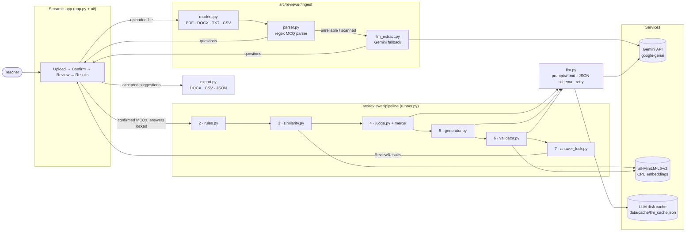

# System architecture

This diagram shows only components that are implemented in this repository.

## Components

**Streamlit UI (`app.py`, `ui/components.py`, `ui/styles.css`, `.streamlit/config.toml`).** One page with a four-step stepper. It holds all data in `st.session_state`, so button clicks and filters never lose work. The teacher confirms the answer key before anything is reviewed, then accepts or rejects suggestions and downloads the results.

**Readers (`ingest/readers.py`).** Turn PDF (pdfplumber, with page markers), DOCX (paragraphs and table cells, in order), TXT and SciQ-style CSV into text or question rows.

**Regex parser (`ingest/parser.py`).** Finds numbered questions, A–D options (one per line or all on one line) and answers (`Answer: B`, `Ans. (b)`, an answer-key block, …). It never guesses: a question without a marked answer gets `None`.

**Gemini fallback extractor (`ingest/llm_extract.py`).** Used only when the PDF is scanned (the PDF bytes go straight to Gemini) or the parser result looks unreliable. The prompt `prompts/extract.md` demands verbatim copying and no guessed answers.

**LLM client (`llm.py`).** Every Gemini call in the pipeline goes through here. It fills a prompt from `prompts/`, asks for JSON that matches a Pydantic schema, validates the reply, caches it on disk (keyed by model + prompt), and retries on rate limits or server errors. It stops with a clear message when the daily free-tier limit is used up.

**Step 2, rules (`pipeline/rules.py`).** Free, instant text checks: duplicate options, a distractor equal to the answer, answer cues (length, "a"/"an"), and "all/none of the above".

**Step 3, similarity (`pipeline/similarity.py`).** MiniLM embeddings on CPU. It flags a distractor too close to the answer (> 0.85, may also be correct), too far from it (< 0.20, implausible), and near-duplicate distractors (> 0.90). The scores are passed to the judge as hints.

**Step 4, LLM judge (`pipeline/judge.py`).** One Gemini call per question (temperature 0.2). For each distractor it reports whether it is also correct and how tempting it is; it also reports whether the question is ambiguous and whether it agrees with the answer key. It only ever flags the key; it never changes it. A merge keeps one finding per (target, issue type), with the highest severity and every layer that detected it.

**Step 5, generator (`pipeline/generator.py`).** One Gemini call per question asks for 3 misconception-based candidates for every weak distractor (high/medium finding, or duplicate).

**Step 6, validator (`pipeline/validator.py`).** Rejects candidates that equal or resemble the answer, duplicate an option, have a length cue, or use "all/none of the above"; then one batched Gemini verify call rejects any candidate a teacher could mark correct. If nothing survives, generation is retried once with the rejected candidates listed.

**Step 7, answer lock (`pipeline/answer_lock.py`).** A SHA-256 fingerprint of the answer is taken at load time. After the review, the answer must be identical character for character and the fingerprint must match; otherwise the result is discarded and marked `answer_preserved=False`. Together with the frozen `MCQ` model, this gives two independent layers of protection.

**Export (`export.py`).** The revised question paper (DOCX, accepted suggestions only, answers in their original positions plus an answer key), the review report (CSV, one row per finding) and the full results (JSON).

**Services.** The Gemini API via the official `google-genai` SDK; the `all-MiniLM-L6-v2` sentence-transformer, downloaded once and run on CPU; and the JSON disk cache in `data/cache/` (git-ignored).
